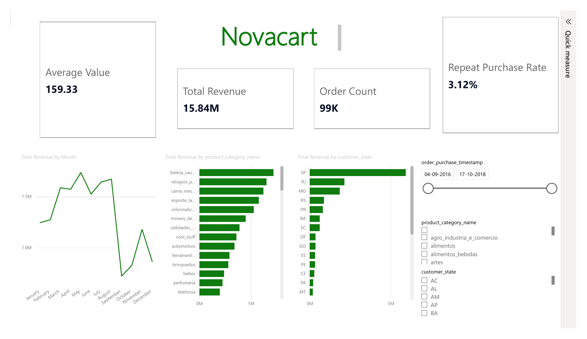

# NovaCart: Personalized Recommendation Engine (Business Analysis Case Study)

A full Business Analyst deliverable set for a personalized product recommendation engine, built on the public **Olist Brazilian E-Commerce dataset** and reframed under the fictional brand **NovaCart** for portfolio purposes. No real company or client is implied.

## Business problem
Most NovaCart customers buy once and never return, and see only what they search for. That limits both **repeat purchase rate** and **average order value (AOV)**. The proposal: recommendations driven by browsing and purchase history, shown on the product page and in post-purchase emails, with an on-site SEO discovery layer.

## What the dashboard shows (Power BI, Olist data)

| Metric | Value |
|---|---|
| Average order value | 159.33 BRL |
| Repeat purchase rate | 3.12% |
| Total revenue | 15.84M BRL |
| Orders | 99K |

The dashboard also breaks revenue down by month, product category and customer state. A repeat rate near 3% is the baseline the recommendation engine is meant to move.

## Documentation (21 pages)
`docs/NovaCart_Recommendation_Engine_Project_Report.docx` covers:
1. **BRD:** objective, scope, stakeholders, 6 business requirements, assumptions, KPIs, risks
2. **Data requirements:** fields, quality rules, freshness, data model
3. **Algorithm specification:** inputs, outputs, business rules
4. **A/B testing requirements:** test design, metrics, success threshold
5. **Privacy and compliance:** requirements mapped to India's DPDP Act, 2023
6. **KPI definitions:** primary, secondary and guardrail KPIs
7. **Analytics dashboard requirements:** executive, model-health and privacy views
8. **Agile backlog and sprint plan:** user stories sized at 45 story points over 2 to 3 sprints

## Files
| Path | What it is |
|---|---|
| `docs/NovaCart_Recommendation_Engine_Project_Report.docx` | The full BA report |
| `dashboard/novacart.pbix` | Power BI dashboard (open in Power BI Desktop) |
| `dashboard/novacart_dashboard.pdf` and `.png` | Dashboard snapshot |

## Notes
- Data: [Olist Brazilian E-Commerce Public Dataset](https://www.kaggle.com/datasets/olistbr/brazilian-ecommerce) on Kaggle. The raw files are not stored here.
- This is a requirements and analytics exercise. The recommendation model itself is specified, not built.

## Author
Vartika Yadav | [LinkedIn](https://www.linkedin.com/in/vartika-yadav-b39a23314) | [Portfolio](https://tortootech.github.io/vartika/)
